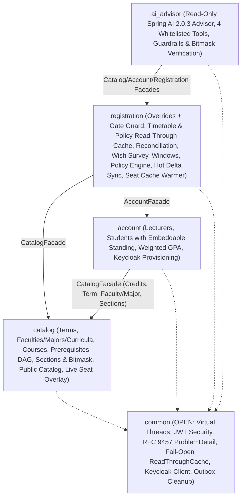
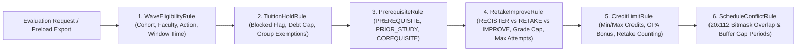
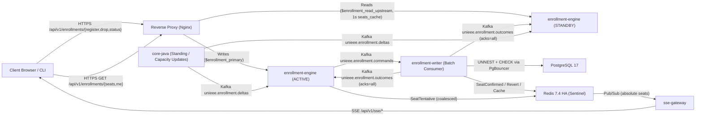

# System Architecture & Database Design

**Language:** **English** | [Tiếng Việt](../vi/architecture.md) | [Documentation Hub](../README.md)

**unieee** combines a **Spring Boot 4.1.3 Modular Monolith** (Warm/Cold Path running 24/7, **`1.0.0`**) with a **Rust Hot Path** (**`1.0.0`**, toggled on cyclically during peak registration windows), unified around **PostgreSQL 17** as the single Source of Truth and **Redis 7.4 HA** strictly as a Read Cache & SSE Pub/Sub backbone.

---

## 1. Hybrid Architecture (Warm/Cold Path vs Hot Path)

| Dimension | Warm / Cold Path (`services/core-java/`) | Hot Path (`services/rust-enrollment/`) |
| :--- | :--- | :--- |
| **Runtime** | Java 25 (Virtual Threads), Spring Boot 4.1.3, Spring Modulith 2.1.2, Spring AI 2.0.3 | Rust, Axum 0.8, Tokio, SQLx 0.8, `rdkafka` (`enrollment-engine`, `enrollment-writer`, `sse-gateway`) |
| **Scope** | Curricula, courses, prerequisites, terms, sections, public catalog (`/api/v1/public/*`), fail-open **Redis Read-Through Cache** (timetable, active policy, static catalog + live seat overlay), Keycloak provisioning, wish surveys, policy engine & snapshot export, registration windows, admin overrides, Redis seat warmer, Hot Delta Sync (`unieee.enrollment.deltas`), reconciliation, Read-Only AI Advisor (`ai_advisor`) | High-concurrency seat reservation & lock-free RAM reads (`/seats`, `/me`), CAS capacity decrement, `O(1)` Bitmask conflict checks, Kafka batch ingestion & durable `unieee.enrollment.outcomes` sync, PostgreSQL `UNNEST` batch commit + Revert, real-time SSE fan-out |
| **Lifecycle** | Active **24/7** (`core` Compose profile) | Activated cyclically before peak waves (`prepare-registration` / `open-registration`) and drained cleanly afterward (`close-registration`) |

### Why Redis Is Not Used as the Seat State Machine
Using Redis Lua scripts or `DECR` per request introduces TCP/RESP round-trips and cross-key coordination overhead when validating multiple coupled rules (waves, tuition debt, prerequisites, retake rules, credit caps, and schedule overlap). Instead, the Rust `enrollment-engine` evaluates rules and reserves seats locally in memory (`#[repr(align(64))]` slots + per-student shards), while **Kafka (`unieee.enrollment.outcomes`)** delivers durable PostgreSQL commit/revert outcomes back to both `ACTIVE` and `STANDBY` engines, and **Redis** serves strictly as Read Cache and SSE/gate Pub/Sub transport (always publishing absolute `availableSeats` & `maxCapacity`).

---

## 2. Spring Modulith Bounded Contexts (`services/core-java/`)

The Core Monolith is organized into **4 Business-Capability Bounded Contexts** atop an open shared kernel (`common`), forming a **strict 1-way linear dependency DAG** verified automatically by `ApplicationModules.of(UnieeeApplication.class).verify()`:

### Module Boundaries, DDD Patterns & Read-Through Cache Strategy
- **Public API vs `internal/`:** Cross-module communication uses only root `*Facade` interfaces, `dto/*Request` / `dto/*Response` (`@NamedInterface("dto")`), and `event/*Event` (`@NamedInterface("event")`). Importing another module's `internal.*` packages fails the build test.
- **Rich Domain Entities & Value Objects:** Domain invariants live inside entities and `@Embeddable` value objects (`CourseSection`, `ScheduleBitmask`, `FinancialStanding`, `AcademicStanding`, `WishSurveyCampaign`, `RegistrationWindow`, `EnrollmentPolicy`), not anemic services.
- **Transactional Outbox Cleanup:** Spring Modulith writes domain events to `public.event_publication` inside the same PostgreSQL transaction; `EventPublicationCleanupJob` periodically purges completed rows (`completion_date IS NOT NULL`) beyond the retention window.
- **Fail-Open Redis Read-Through Cache (`common.cache` -> `catalog` & `registration`):**
  - *Student Timetable (`GET /api/v1/students/me/timetable`):* Cached under `unieee:cache:student:{studentId}:term:{termId}:timetable` with **adaptive TTL** (`45s` during `REGISTRATION_OPEN`, `20m` outside registration hours); invalidated by both `enrollment-writer` (`DEL`) and Core Java `AdminEnrollmentOverrideService` / section schedule & status updates.
  - *Active Policy (`GET /api/v1/policies/terms/{termId}/active`):* Cached for `1h` under `unieee:cache:policy:{termId}:active`; evicted on `updatePolicy` / `activatePolicy`.
  - *Catalog & Live Seat Overlay:* Terms, courses, prerequisites, and static section metadata cache for `30m–45m` and are evicted on domain mutations; `GET /api/v1/sections` and `ai_advisor` merge static metadata with live Redis seat counts (`unieee:cache:term:{termId}:sections` / `unieee:cache:section:{sectionId}:seats`).
  - *Never Cached Authoritative Paths:* `reconcileTerm`, `listStudentEnrollmentEvents`, `getSectionRoster`, and Hot Delta / `warm-cache` lookups (`*Authoritative()` methods) always query PostgreSQL directly.

---

## 3. PostgreSQL Schema-per-Bounded-Context (`V001`–`V005`)

Each Bounded Context owns its PostgreSQL schema, with **zero cross-schema foreign keys**:

| Schema | Migration | Tables | Key Invariants & Design Notes |
| :--- | :--- | :--- | :--- |
| `public` | `V001` | `event_publication` | Spring Modulith Transactional Outbox with partial indexes on `completion_date`. |
| `catalog` | `V002` | `academic_terms`, `faculties`, `majors`, `curricula`, `courses`, `curriculum_courses`, `course_prerequisites`, `course_sections`, `section_schedules` | `curriculum_courses` references `course_id`; prerequisite graph enforces cycle detection via DFS; `course_sections` stores 640-char hex `schedule_bitmask_hex` (20 weeks x 112 bits) and `CHECK (max_capacity >= 0 AND enrolled_count >= 0 AND enrolled_count <= max_capacity)`. |
| `account` | `V003` | `lecturers`, `students`, `student_course_results` | `students` stays flat in PostgreSQL for 1-query Rust preload while mapping to `@Embeddable` `FinancialStanding` & `AcademicStanding` in Java; `student_course_results` enforces `UNIQUE (student_id, course_id, attempt_number)`. |
| `registration` | `V004` | `enrollments`, `enrollment_events`, `writer_revert_outbox` | Partial unique index `uq_enrollments_active_student_course ON (term_id, student_id, course_id) WHERE status = 'CONFIRMED'`; append-only `enrollment_events` with `BIGSERIAL seq` for replay/audit *(retained `writer_revert_outbox` DDL is preserved for clean Flyway history; runtime outcome sync now uses Kafka `unieee.enrollment.outcomes`)*. |
| `registration` | `V005` | `wish_survey_campaigns`, `wish_survey_entries`, `enrollment_policies`, `enrollment_policy_snapshots`, `registration_windows` | `uq_survey_student_course` prevents duplicate wishes per campaign; partial unique index `uq_enrollment_policies_active_term` guarantees at most one `active = TRUE` policy per term; immutable JSONB snapshots with SHA-256 checksums. |

---

## 4. Single-Writer Gate Guard & Policy Engine

### Single-Writer Gate Guard
While an academic term is in `REGISTRATION_OPEN`, the Rust Hot Path exclusively owns seat mutations in `catalog.course_sections` and `registration.enrollments`. Any Core Java admin mutation (`ADMIN_ADD`, `ADMIN_DROP`, `ADMIN_TRANSFER`) checks term status via `CatalogFacade` and fails immediately with **`409 Conflict` (`errorCode = "REGISTRATION_GATE_OPEN"`)**.

### Multi-University Configurable Policy Engine
To support different university academic regulations without modifying core code, `EnrollmentPolicy` combines typed columns with extensible `extended_rules` (`JSONB`) evaluated by an ordered Strategy chain (`EnrollmentRuleEvaluator`):

Before opening registration, `PolicySnapshotExporter` compiles the active policy and non-closed windows into a canonical sorted JSON payload, computes its SHA-256 checksum, persists an immutable row in `registration.enrollment_policy_snapshots`, writes to Redis key `unieee:cache:policy:{termId}:snapshot` (best-effort), and publishes `PolicySnapshotExportedEvent`.

---

## 5. Rust Hot Path Cluster (`services/rust-enrollment/`)

### Shared Workspace Crates (`crates/`)
- **`unieee-domain`:** Strongly typed domain IDs (`TermId`, `StudentId`, `CourseId`, `SectionId`, `EventId`, `WindowId`), `RuleErrorCode`, unified RFC 9457 `ProblemDetail`, and `ScheduleBitmask` (`[u128; 20]` — 20 weeks x 112 bits) supporting `O(1)` bitwise overlap and buffer-gap checks verified against an interval oracle via `proptest`.
- **`unieee-events`:** Versioned JSON codecs (`EVENT_SCHEMA_VERSION_V1`) for Kafka messages (`EnrollmentCommandEvent`, `EnrollmentOutcomeEvent`, `EnrollmentDeltaEvent`, `DeadLetterEvent`) and Redis Pub/Sub payloads (`SeatTentativeEvent`, `SeatConfirmedEvent`, `RevertEvent`, `GateControlEvent`), plus canonical topic and key helpers.
- **`unieee-cacheline`:** `#[repr(align(64))]` cache-line aligned `SectionSeatSlot` (compile-time & test verified `align_of::<SectionSeatSlot>() == 64` to prevent false sharing) and lock-free sharded student state (`ShardedMap`).

### Hot Path Dataflow, Kafka Outcomes Sync & Read/Write Split

### Resilience, Read/Write Split & Crash-Safe Outcome Delivery
- **Crash-Safe At-Least-Once Outcomes & Chunked `UNNEST` Writes (`enrollment-writer` -> Kafka):** `enrollment-writer` splits mixed same-student/course churn chronologically into contiguous conflict-free waves (`split_into_conflict_free_chunks`) so PostgreSQL `UNNEST` fast-batch stays high-throughput (falling back per chunk only on constraint/missing-section conflicts), pipelines `acks=all` `EnrollmentOutcomeEvent` (`CONFIRMED` / `REVERTED`) produces to `unieee.enrollment.outcomes` concurrently via `try_join_all`, and commits `unieee.enrollment.commands` offsets ONLY after both PostgreSQL and outcome produce succeed. On crash-recovery encountering a duplicate `event_id`, it reloads the persisted outcome from `registration.enrollment_events` and re-emits `EnrollmentOutcomeEvent`.
- **Dynamic Nginx Read/Write Split & `1s` `seats_cache`:** `/api/v1/enrollments/seats` and `/api/v1/enrollments/me` route to `$enrollment_read_upstream` (`STANDBY` when healthy & `READY`), offloading read traffic from the write primary. On primary crash or while a recovered Standby is `SYNCING` (`/readyz = 503`), reads transparently route to the surviving `ACTIVE` node protected by a `1s` `seats_cache` (`proxy_cache_lock on`, bypassing cache when `Authorization` is empty). Once Standby completes Kafka replay, reads automatically split back while writes stay pinned with zero auto-failback.
- **Non-Blocking Auth & Coalesced Pub/Sub:** `enrollment-engine` and `sse-gateway` verify Keycloak JWTs locally via singleflight JWKS refresh (`JWKS_REFRESH_INTERVAL_SECS=300`) + SHA-256 token cache (`JWT_CACHE_TTL_SECS=30`). `SeatTentativeEvent` and `SeatConfirmedEvent` always carry absolute `availableSeats` / `maxCapacity` so SSE clients self-heal if a Pub/Sub frame drops.
- **Zero-PG Snapshot Recovery & RAM-First Revert Idempotency:** Engines persist atomic disk snapshots (`SNAPSHOT_DIR`, SHA-256 + `checkpoint_seq`) and recover via snapshot + Kafka replay (`commands` + `deltas` + `outcomes`) with zero PostgreSQL queries, handling out-of-order `commands`/`outcomes` partitions idempotently in RAM (`processed_event_ids` / `reverted_event_ids`).

---

## 6. Event Bus, Redis Keys & Pub/Sub Backbone

| Transport | Identifier | Producer(s) -> Consumer(s) | Purpose |
| :--- | :--- | :--- | :--- |
| **Kafka Topic** | `unieee.enrollment.commands` *(12 partitions)* | `enrollment-engine` -> `enrollment-writer`, Standby, replay | Durable enrollment/drop command stream partitioned by `student_id`. |
| **Kafka Topic** | `unieee.enrollment.outcomes` *(12 partitions)* | `enrollment-writer` -> `enrollment-engine` (Active & Standby), replay | Crash-safe `EnrollmentOutcomeEvent` (`CONFIRMED`/`REVERTED`) stream partitioned by `student_id`. |
| **Kafka Topic** | `unieee.enrollment.deltas` *(6 partitions)* | `core-java` (`KafkaHotDeltaPublisher`) -> `enrollment-engine` (Active & Standby) | Live `StudentStandingUpdatedEvent` & `SectionCapacityUpdatedEvent` updates during `REGISTRATION_OPEN`. |
| **Kafka Topic** | `unieee.enrollment.dlq` *(3 partitions)* | `enrollment-writer` -> ops inspection | Dead-letter queue for malformed/unrecoverable Kafka payloads. |
| **Redis Pub/Sub** | `unieee:seat:tentative` | `enrollment-engine` -> `sse-gateway` | Coalesced absolute-seat updates from RAM (`TENTATIVE`). |
| **Redis Pub/Sub** | `unieee:seat:confirmed` | `enrollment-writer` -> `sse-gateway` | PostgreSQL-committed absolute seat & personal confirmations (`CONFIRMED`). |
| **Redis Pub/Sub** | `unieee:enrollment:revert` | `enrollment-writer` -> `sse-gateway` | Compensating revert fan-out for SSE personal streams (`REVERTED`). |
| **Redis Pub/Sub** | `unieee:gate:control` | `scripts/unieee.sh` -> `enrollment-engine`, `sse-gateway` | Synchronized gate transitions (`OPEN`, `DRAINING`, `CLOSED`) and wave switches with fencing `epoch`. |
| **Redis Keys** | `unieee:cache:term:{termId}:sections` `unieee:cache:section:{sectionId}:seats` `unieee:cache:student:{studentId}:term:{termId}:timetable` `unieee:cache:policy:{termId}:active` `unieee:cache:policy:{termId}:snapshot` `unieee:cache:catalog:{terms\|term:*\|courses\|course:*\|course:*:prerequisites\|sections:term:*\|section:*:detail}` `unieee:event:status:{eventId}` `unieee:revert:dedup:{eventId}` | `core-java` & `enrollment-writer` -> `core-java`, `ai_advisor`, `enrollment-engine` | Read-Through Cache (catalog, active policy, adaptive timetable), live seat overlay (`warm-cache` & post-commit sync), policy snapshot cache, async event status lookup, and 24h revert dedup backup. |

---

## 7. Production Observability Architecture (`infra/compose.monitoring.yml`)

- **Instrumentation:** `core-java` exposes Micrometer `/actuator/prometheus` (`UnieeeMetrics` covering Redis Read-Through Cache hit/miss/fallback, Seat Overlay, Policy Engine, Admin Override, Hot Delta Sync, and AI Advisor); all 3 Rust services expose `/metrics` via `metrics-exporter-prometheus`.
- **Internal Scraping & Network Isolation:** **Prometheus** (`127.0.0.1:9090`, `--web.enable-remote-write-receiver` for `k6`) scrapes internal-network targets over `app`/`data` (`core-java:8080`, `enrollment-engine-{active,standby}:8081`, `enrollment-writer:8082`, `sse-gateway:8083`, `nginx-exporter:9113` via Nginx `:8089 /stub_status`, `postgres-exporter:9187`, `pgbouncer-exporter:9127`, multi-target `redis-exporter:9121`, and `hot-path` `kafka-exporter:9308`). **PostgreSQL, PgBouncer, Redis, Kafka, and exporters publish zero host ports.**
- **Dashboards:** **Grafana** (`127.0.0.1:3000`) auto-provisions the Prometheus datasource and two dashboards (`unieee-production-overview` and `unieee-k6-benchmark`).
