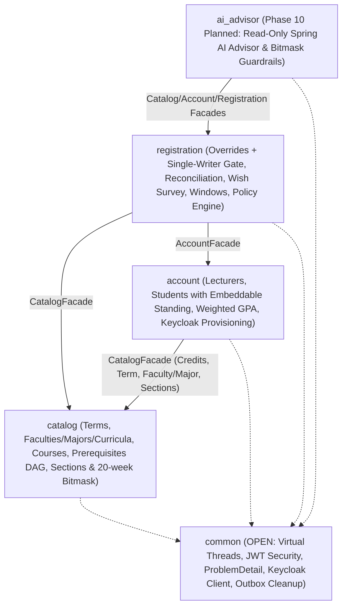
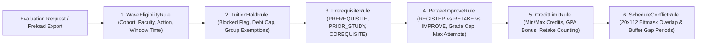

# System Architecture & Database Design

**Language:** **English** | [Tiếng Việt](../vi/architecture.md) | [Documentation Hub](../README.md)

**unieee** combines a **Spring Boot 4.1.2 Modular Monolith** (Warm/Cold Path running 24/7) with a planned **Rust Hot Path** (toggled on during peak registration windows), unified around **PostgreSQL** as the single Source of Truth and **Redis HA** strictly as a Read Cache & Pub/Sub backbone.

---

## 1. Hybrid Architecture (Warm/Cold Path vs Hot Path)

| Dimension | Warm / Cold Path (`services/core-java/`) | Hot Path (`services/rust-enrollment/` — Phases 6–9) |
| :--- | :--- | :--- |
| **Runtime** | Java 21 (Virtual Threads), Spring Boot 4.1.2, Spring Modulith 2.1.2 | Rust, Axum, Tokio (`enrollment-engine`, `enrollment-writer`, `sse-gateway`) |
| **Scope** | Curricula, courses, prerequisites, terms, sections, Keycloak provisioning, wish surveys, policy engine & snapshot export, registration windows, admin overrides, reconciliation, AI advisor (Phase 10) | High-concurrency seat reservation in RAM, lock-free CAS capacity decrement, `O(1)` Bitmask conflict checks, Kafka batch ingestion, PostgreSQL `UNNEST` batch commit + Revert, real-time SSE fan-out |
| **Lifecycle** | Active **24/7** (`core` Compose profile) | Activated cyclically before peak waves (`prepare-registration` / `open-registration`) and drained cleanly afterward (`close-registration`) |

### Why Redis Is Not Used as the Seat State Machine
Using Redis Lua scripts or `DECR` per request introduces TCP/RESP round-trips and cross-key coordination overhead when validating multiple coupled rules (waves, tuition debt, prerequisites, retake rules, credit caps, and schedule overlap). Instead, the Rust `enrollment-engine` evaluates rules and reserves seats locally in memory (`#[repr(align(64))]` slots + per-student shards), while Redis serves strictly as Read Cache and Pub/Sub transport.

---

## 2. Spring Modulith Bounded Contexts (`services/core-java/`)

The Core Monolith is organized into **4 Business-Capability Bounded Contexts** atop an open shared kernel (`common`), forming a **strict 1-way linear dependency DAG** verified automatically by `ApplicationModules.of(UnieeeApplication.class).verify()`:

### Module Boundaries & DDD Patterns
- **Public API vs `internal/`:** Cross-module communication uses only root `*Facade` interfaces, `dto/*Request` / `dto/*Response` (`@NamedInterface("dto")`), and `event/*Event` (`@NamedInterface("event")`). Importing another module's `internal.*` packages fails the build test.
- **Rich Domain Entities & Value Objects:** Domain invariants live inside entities and `@Embeddable` value objects (`CourseSection`, `ScheduleBitmask`, `FinancialStanding`, `AcademicStanding`, `WishSurveyCampaign`, `RegistrationWindow`, `EnrollmentPolicy`), not anemic services.
- **Transactional Outbox Cleanup:** Spring Modulith writes domain events to `public.event_publication` inside the same PostgreSQL transaction; `EventPublicationCleanupJob` periodically purges completed rows (`completion_date IS NOT NULL`) beyond the retention window.

---

## 3. PostgreSQL Schema-per-Bounded-Context (`V001`–`V005`)

Each Bounded Context owns its PostgreSQL schema, with **zero cross-schema foreign keys**:

| Schema | Migration | Tables | Key Invariants & Design Notes |
| :--- | :--- | :--- | :--- |
| `public` | `V001` | `event_publication` | Spring Modulith Transactional Outbox with partial indexes on `completion_date`. |
| `catalog` | `V002` | `academic_terms`, `faculties`, `majors`, `curricula`, `courses`, `curriculum_courses`, `course_prerequisites`, `course_sections`, `section_schedules` | `curriculum_courses` references `course_id`; prerequisite graph enforces cycle detection via DFS; `course_sections` stores 640-char hex `schedule_bitmask_hex` (20 weeks x 112 bits) and `CHECK (max_capacity >= 0 AND enrolled_count >= 0 AND enrolled_count <= max_capacity)`. |
| `account` | `V003` | `lecturers`, `students`, `student_course_results` | `students` stays flat in PostgreSQL for 1-query Rust preload while mapping to `@Embeddable` `FinancialStanding` & `AcademicStanding` in Java; `student_course_results` enforces `UNIQUE (student_id, course_id, attempt_number)`. |
| `registration` | `V004` | `enrollments`, `enrollment_events`, `writer_revert_outbox` | Partial unique index `uq_enrollments_active_student_course ON (term_id, student_id, course_id) WHERE status = 'CONFIRMED'`; append-only `enrollment_events` with `BIGSERIAL seq` for replay/audit. |
| `registration` | `V005` | `wish_survey_campaigns`, `wish_survey_entries`, `enrollment_policies`, `enrollment_policy_snapshots`, `registration_windows` | `uq_survey_student_course` prevents duplicate wishes per campaign; partial unique index `uq_enrollment_policies_active_term` guarantees at most one `active = TRUE` policy per term; immutable JSONB snapshots with SHA-256 checksums. |

---

## 4. Single-Writer Gate Guard & Policy Engine

### Single-Writer Gate Guard
While an academic term is in `REGISTRATION_OPEN`, the Rust Hot Path exclusively owns seat mutations in `catalog.course_sections` and `registration.enrollments`. Any Core Java admin mutation (`ADMIN_ADD`, `ADMIN_DROP`, `ADMIN_TRANSFER`) checks term status via `CatalogFacade` and fails immediately with **`409 Conflict` (`errorCode = "REGISTRATION_GATE_OPEN"`)**.

### Multi-University Configurable Policy Engine (Phase 5)
To support different university academic regulations without modifying core code, `EnrollmentPolicy` combines typed columns with extensible `extended_rules` (`JSONB`) evaluated by an ordered Strategy chain (`EnrollmentRuleEvaluator`):

Before opening registration, `PolicySnapshotExporter` compiles the active policy and non-closed windows into a canonical sorted JSON payload, computes its SHA-256 checksum, persists an immutable row in `registration.enrollment_policy_snapshots`, writes to Redis key `unieee:cache:policy:{termId}:snapshot` (best-effort), and publishes `PolicySnapshotExportedEvent`.
