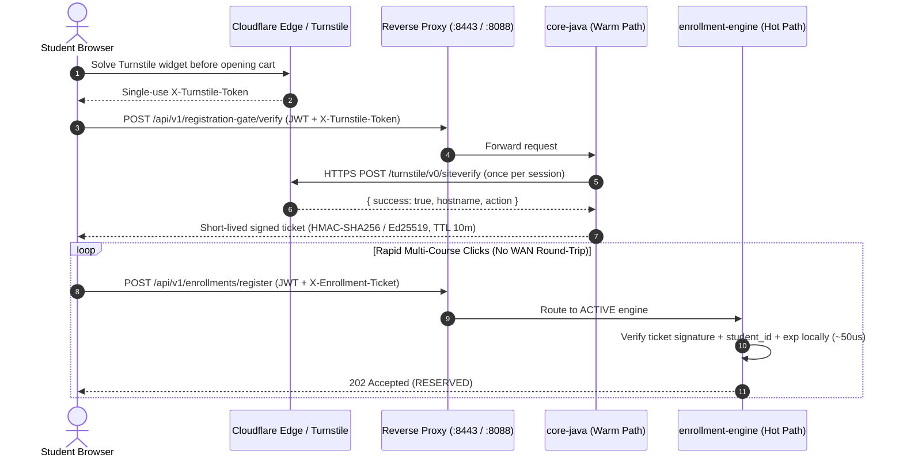
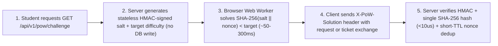

# Rate Limiting & Anti-Bot Architecture Guide

**Language:** **English** | [Tiếng Việt](../vi/rate-limiting-and-anti-bot.md) | [Documentation Hub](../README.md)

During course registration peaks, automated scripts (*bots*) and flash crowds both generate extreme request rates, often behind shared university campus NAT IP addresses. **unieee** protects system fairness and stability using **per-service Token Bucket rate limiting** keyed by authenticated user identity (`student_id` / OIDC `sub`), isolated cleanly from load-testing overlays, and prepares architectural hooks for **Cloudflare Turnstile** and **self-hosted Proof-of-Work (ALTCHA / WebCrypto Hashcash)**.

---

## 1. Per-Service Token Bucket Rate Limiting

### Why Nginx IP Limits Alone Are Not Enough
Edge rate limiting in [nginx.conf](../../infra/reverse-proxy/nginx.conf) keys on `$binary_remote_addr`. On a university campus network or dorm Wi-Fi, hundreds or thousands of legitimate students share a single public NAT IP. Relying solely on edge IP throttling forces an undesirable trade-off:
- **Too strict at the edge:** Legitimate students sharing a campus IP receive `429` errors because of a few noisy neighbors.
- **Too loose at the edge:** One student running an automated script can flood `POST /api/v1/enrollments/register` or repeatedly open/close SSE streams without triggering IP-wide protection.

**unieee** therefore enforces **application-level Token Bucket rate limiting** at every user-facing service, keying buckets primarily on the verified JWT identity (`student_id` -> `lecturer_id` -> `sub`) and falling back to client IP (`X-Real-IP` / `X-Forwarded-For`) only when no JWT is present.

### Service Bucket Configuration & Defaults

| Service | Bucket | Matched Routes | Bucket Key | Default Burst (`capacity`) | Default Refill Rate | Metrics |
| :--- | :--- | :--- | :--- | :---: | :---: | :--- |
| **`core-java`** | `public_catalog` | `/api/v1/public/**` | Client IP | `60` | `20.0 req/s` | `unieee_rate_limit_requests_total{service="core-java",bucket="public_catalog"}` |
| **`core-java`** | `general_api` | `/api/v1/**` *(excl. public & AI)* | `student_id` / `lecturer_id` / `sub` *(fallback IP)* | `120` | `40.0 req/s` | `unieee_rate_limit_requests_total{service="core-java",bucket="general_api"}` |
| **`core-java`** | `ai_advisor` | `/api/v1/ai/**` | `student_id` / `sub` | `6` | `0.2 req/s` *(1 per 5s)* | `unieee_rate_limit_requests_total{service="core-java",bucket="ai_advisor"}` |
| **`enrollment-engine`** | `write` | `POST /api/v1/enrollments/{register,drop}` | `student_id` / `sub` *(fallback IP)* | `10` | `2.0 req/s` | `unieee_engine_rate_limit_total{bucket="write"}` |
| **`enrollment-engine`** | `read` | `GET /api/v1/enrollments/{seats,me,status/*}` | `student_id` / `sub` *(fallback IP)* | `40` | `15.0 req/s` | `unieee_engine_rate_limit_total{bucket="read"}` |
| **`sse-gateway`** | `connect` | `GET /api/v1/sse/{sections,me}` | `student_id` / `sub` *(fallback IP)* | `10` | `2.0 req/s` | `unieee_sse_rate_limit_total{bucket="connect"}` |

### Memory Safety, Lock-Free Sharding & RFC 9457 Response Contract
- **No Global Lock on Hot Path:** Both `enrollment-engine` and `sse-gateway` share `ShardedTokenBucket` in `crates/unieee-cacheline`, sharded across `256` `#[repr(align(64))]` cache-line padded buckets using FNV-1a hashing and exact `u128` micro-token accounting.
- **Bounded RAM & Idle Eviction:** Background sweepers periodically evict buckets idle beyond `idle_ttl` (`10m` default), and new-key insertions enforce hard upper bounds (`maxBuckets` / `max_entries`) by evicting idle or oldest entries first to eliminate memory-exhaustion risks across multi-day windows.
- **Standard Headers & RFC 9457 Payload:** Allowed responses include `X-RateLimit-Limit` and `X-RateLimit-Remaining`. Rejected requests return **`429 Too Many Requests`** (`Content-Type: application/problem+json`) with `Retry-After`:

```json
{
  "type": "urn:unieee:error:RATE_LIMIT_EXCEEDED",
  "title": "Too Many Requests",
  "status": 429,
  "detail": "Rate limit exceeded for 'write'. Please retry after 1 second(s).",
  "instance": "/api/v1/enrollments/register",
  "errorCode": "RATE_LIMIT_EXCEEDED",
  "timestamp": "2026-11-27T03:00:00Z"
}
```

### Strict Separation from Load Benchmarks
All rate limiters are **enabled by default** (`UNIEEE_RATE_LIMIT_ENABLED=true`, `RATE_LIMIT_ENABLED=true`) in [compose.base.yml](../../infra/compose.base.yml) and [compose.hotpath.yml](../../infra/compose.hotpath.yml). To measure raw system capacity without artificial throttling, [tests/load/run-benchmarks.sh](../../tests/load/run-benchmarks.sh) applies the isolated overlay [tests/load/compose.bench.yml](../../tests/load/compose.bench.yml) (`--disable-rate-limit`), which:
1. Lifts single-source-IP ceilings in Nginx (`nginx-bench.conf`) and sets `UNIEEE_RATE_LIMIT_ENABLED=false` / `RATE_LIMIT_ENABLED=false`.
2. Logs an explicit **`SECURITY WARNING`** on service startup and sets `unieee_rate_limit_enabled=0` / `rateLimitEnabled: false` in health & Prometheus probes.
3. Automatically restores every patched service back to production defaults inside a `trap ... EXIT` handler when the benchmark finishes or is interrupted.

---

## 2. Integrating Cloudflare Turnstile (Recommended Architecture)

**Status:** Architectural guide & extension placeholders prepared (`AntiBotVerificationHook`, `unieee.rate-limit.anti-bot.*`, `X-Turnstile-Token` header convention). Challenge enforcement is **not active yet** (`enabled=false` by default).

### Why Synchronous `siteverify` Must NEVER Run on the Hot Path
Calling Cloudflare's verification endpoint (`https://challenges.cloudflare.com/turnstile/v0/siteverify`) synchronously inside `POST /api/v1/enrollments/register` would undermine the core Hot Path architecture:
1. **100–300 ms Network Penalty:** The Rust `enrollment-engine` processes requests in RAM in under `1 ms` (`p95`). Adding an outbound HTTPS TLS round-trip per registration call explodes tail latency (`p95`/`p99`) and ties up async HTTP client connection pools under flash crowds.
2. **External Dependency & API Rate Limits:** If 20,000 students click "Register" in the first 3 seconds, 20,000 concurrent `siteverify` calls can hit Cloudflare verification quotas or fail during transient WAN jitter—blocking enrollment even when PostgreSQL, Kafka, Redis, and Rust RAM are completely healthy.
3. **Single-Use Token Friction:** Turnstile tokens are single-use. Students registering 4–6 sections in rapid succession or retrying via `Idempotency-Key` would need a fresh widget execution on every single click.

### Recommended Pattern: Pre-Registration Enrollment Gate Ticket

Verify Cloudflare Turnstile **once per session or wave transition** in `core-java` (Warm Path), and issue a short-lived cryptographic **Enrollment Gate Ticket** verified locally in RAM by Rust (`~50 µs`, zero external I/O):



### Coordinating with `--tls-mode cloudflared` & Nginx `:8088`
- **Trusted Real IP Extraction:** When deploying via `./scripts/unieee.sh up --tls-mode cloudflared`, traffic enters Nginx on internal port `:8088`. Configure `ngx_http_realip_module` (`set_real_ip_from` restricted strictly to the internal container subnet where `cloudflared` runs, `real_ip_header CF-Connecting-IP;`) so `X-Real-IP` reflects the true client IP rather than the `cloudflared` container IP, while still relying on `student_id` JWT buckets for fairness on NAT networks.
- **Prepared Extension Hooks in `core-java`:** [AntiBotVerificationHook.java](../../services/core-java/src/main/java/vn/edu/unieee/common/ratelimit/AntiBotVerificationHook.java) is already wired into [TokenBucketRateLimitFilter.java](../../services/core-java/src/main/java/vn/edu/unieee/common/ratelimit/TokenBucketRateLimitFilter.java) alongside `unieee.rate-limit.anti-bot.*` configuration keys in [application.yml](../../services/core-java/src/main/resources/application.yml) (`enabled: false`, `turnstile-header: X-Turnstile-Token`). When implementing Turnstile later, register a custom `AntiBotVerificationHook` bean (or dedicated gate controller) without touching the filter chain.

---

## 3. Self-Hosted Proof-of-Work Alternatives (ALTCHA & WebCrypto Hashcash)

For university intranets, air-gapped exam/registration labs, or teams wanting **zero third-party CAPTCHA vendor dependency**, a self-hosted **Proof-of-Work (PoW)** challenge provides deterministic bot friction using standard browser **WebCrypto API** (`crypto.subtle.digest`).

### Stateless Challenge–Response Flow (ALTCHA / SHA-256 Hashcash)



- **ALTCHA Format:** Uses a compact signed JSON challenge (`{ algorithm: "SHA-256", challenge, maxnumber, salt, signature }`) solved asynchronously in a Web Worker with an accessible widget (no visual puzzles).
- **Zero Hot Path Bottleneck:** Verification requires one HMAC check plus one SHA-256 hash (`< 10 µs` in Rust or Java) and one short-TTL salt replay check in `ShardedMap` / Redis.

### Adaptive Difficulty Coupled to Token Bucket State

Because **unieee** already tracks per-student `remaining` tokens in `TokenBucketRateLimiter` and `ShardedTokenBucket`, PoW difficulty can scale dynamically based on how aggressively a caller consumes their bucket:

| Token Bucket State | Recommended Difficulty | Client Solve Time (Browser) | Purpose |
| :--- | :---: | :---: | :--- |
| Normal (`remaining >= 50%` capacity) | `0` *(skip PoW)* | `0 ms` | Zero friction for normal human click speeds. |
| Elevated (`remaining < 50%` capacity) | Low (`~50k` hashes) | `~50–150 ms` | Imperceptible to humans; slows automated tight-loop polling. |
| Critical (`remaining == 0` / repeated `429`) | High (`~250k–500k` hashes) | `~300–900 ms` | Forces exponential client CPU cost onto headless scripts until bucket refills. |

---

## 4. Comparison: Cloudflare Turnstile vs Self-Hosted PoW

| Criterion | Cloudflare Turnstile (Gate Ticket) | Self-Hosted PoW (ALTCHA / Hashcash) |
| :--- | :--- | :--- |
| **External Network Dependency** | Requires outbound HTTPS to `challenges.cloudflare.com` (for widget + `siteverify`). | **None** — works 100% inside campus LAN / intranet. |
| **Hot Path Latency Impact** | `~50 µs` when using Pre-Registration Gate Ticket *(must never call `siteverify` per `/register`)*. | `< 10 µs` local SHA-256 + HMAC verification. |
| **Detection Signal** | Browser telemetry, TLS fingerprint, Cloudflare threat intelligence, behavioral signals. | Deterministic CPU cost per challenge (does not detect headless browsers alone, only throttles throughput). |
| **Privacy & Compliance** | Sends client telemetry to Cloudflare. | **100% self-hosted**, zero external data sharing. |
| **UX on Slow Devices** | Usually invisible or single click; fails if Cloudflare JS is blocked by campus proxy. | Smooth in Web Worker for moderate difficulty; high difficulty drains battery on low-end phones. |
| **Recommended Role in `unieee`** | **Primary human gate** when internet/Cloudflare edge is available (issue 10m Gate Ticket in `core-java`). | **Adaptive per-request / fallback gate** triggered when Token Bucket remaining quota drops or when deployed offline on campus LAN. |
