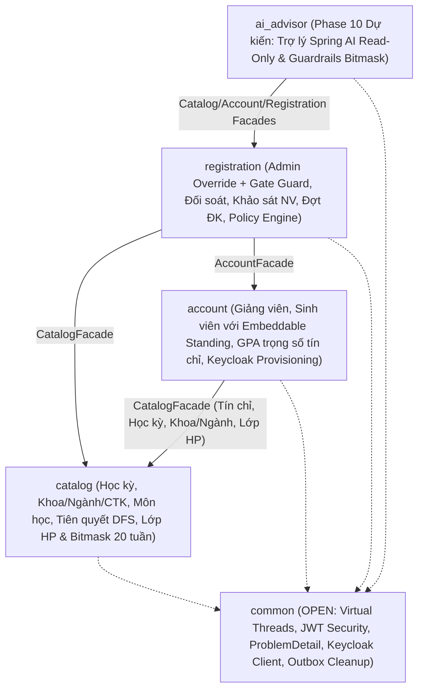
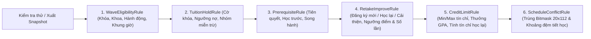

# Kiến trúc Hệ thống & Thiết kế CSDL

**Ngôn ngữ:** [English](../en/architecture.md) | **Tiếng Việt** | [Trung tâm Tài liệu](../README.vi.md)

**unieee** kết hợp một **Spring Boot 4.1.2 Modular Monolith** (Warm/Cold Path chạy 24/7) với cụm **Rust Hot Path** đang trong lộ trình (bật theo chu kỳ mở cổng), xoay quanh **PostgreSQL** làm Source of Truth duy nhất và **Redis HA** chỉ đóng vai trò Read Cache & Pub/Sub.

---

## 1. Kiến trúc Lai (Warm/Cold Path vs Hot Path)

| Tiêu chí | Warm / Cold Path (`services/core-java/`) | Hot Path (`services/rust-enrollment/` — Phases 6–9) |
| :--- | :--- | :--- |
| **Nền tảng** | Java 21 (Virtual Threads), Spring Boot 4.1.2, Spring Modulith 2.1.2 | Rust, Axum, Tokio (`enrollment-engine`, `enrollment-writer`, `sse-gateway`) |
| **Phạm vi** | Chương trình khung, môn học, tiên quyết, học kỳ, lớp học phần, cấp phát Keycloak, khảo sát nguyện vọng, Policy Engine & export snapshot, đợt đăng ký, can thiệp Admin, đối soát, AI Advisor (Phase 10) | Giữ ghế tốc độ cao trong RAM, trừ ghế CAS lock-free, kiểm tra trùng lịch Bitmask `O(1)`, Kafka batch ingestion, SQL `UNNEST` batch commit + Revert, fan-out SSE thời gian thực |
| **Vòng đời** | Chạy **24/7** (`core` Compose profile) | Bật trước giờ vàng (`prepare-registration` / `open-registration`) và drain sạch trước khi tắt (`close-registration`) |

### Vì sao không dùng Redis làm State Machine giữ ghế?
Dùng Redis Lua script hoặc `DECR` theo từng request phát sinh chi phí network round-trip TCP/RESP và khó phối hợp nhiều ràng buộc lồng nhau (đợt đăng ký, nợ học phí, tiên quyết, quy tắc học lại/cải thiện, trần tín chỉ và trùng lịch). Trong **unieee**, `enrollment-engine` tự kiểm tra toàn bộ quy chế và trừ ghế ngay trong RAM (`#[repr(align(64))]` + sharding theo sinh viên), còn Redis chỉ dùng cho Read Cache và Pub/Sub.

---

## 2. Các Bounded Contexts Spring Modulith (`services/core-java/`)

Core Java được tổ chức thành **4 Bounded Contexts theo Business Capability** trên nền module mở dùng chung (`common`), tạo thành **đồ thị phụ thuộc tuyến tính 1 chiều (không vòng lặp)** được kiểm chứng tự động bằng `ApplicationModules.of(UnieeeApplication.class).verify()`:

### Nguyên tắc Thiết kế Module & DDD
- **Public API vs `internal/`:** Giao tiếp liên module chỉ đi qua interface `*Facade`, DTO `*Request`/`*Response` (`@NamedInterface("dto")`) và Domain Event `*Event` (`@NamedInterface("event")`). Mọi import vào `*.internal.*` của module khác đều bị test kiến trúc chặn đứng.
- **Rich Domain Entity & `@Embeddable` Value Objects:** Bất biến nghiệp vụ nằm trực tiếp trong Entity và Value Object (`CourseSection`, `ScheduleBitmask`, `FinancialStanding`, `AcademicStanding`, `WishSurveyCampaign`, `RegistrationWindow`, `EnrollmentPolicy`).
- **Outbox Cleanup Job:** Spring Modulith ghi sự kiện vào `public.event_publication` trong cùng transaction với dữ liệu; `EventPublicationCleanupJob` định kỳ dọn các bản ghi đã hoàn tất (`completion_date IS NOT NULL`) quá ngưỡng retention.

---

## 3. PostgreSQL Schema-per-Bounded-Context (`V001`–`V005`)

Mỗi Bounded Context sở hữu schema PostgreSQL riêng, **tuyệt đối không đặt Foreign Key xuyên schema**:

| Schema | Migration | Bảng dữ liệu | Ràng buộc & Thiết kế nổi bật |
| :--- | :--- | :--- | :--- |
| `public` | `V001` | `event_publication` | Spring Modulith Transactional Outbox kèm partial index theo `completion_date`. |
| `catalog` | `V002` | `academic_terms`, `faculties`, `majors`, `curricula`, `courses`, `curriculum_courses`, `course_prerequisites`, `course_sections`, `section_schedules` | `curriculum_courses` tham chiếu `course_id`; phát hiện vòng lặp tiên quyết bằng DFS; `course_sections` lưu `schedule_bitmask_hex` (640 ký tự hex = 20 tuần x 112 bit) và `CHECK (max_capacity >= 0 AND enrolled_count >= 0 AND enrolled_count <= max_capacity)`. |
| `account` | `V003` | `lecturers`, `students`, `student_course_results` | `students` giữ bảng phẳng trên PG để Rust preload 1 query không JOIN, map sang `@Embeddable` `FinancialStanding` & `AcademicStanding` trong Java; `student_course_results` khóa trùng bằng `UNIQUE (student_id, course_id, attempt_number)`. |
| `registration` | `V004` | `enrollments`, `enrollment_events`, `writer_revert_outbox` | Partial unique index `uq_enrollments_active_student_course ON (term_id, student_id, course_id) WHERE status = 'CONFIRMED'`; bảng append-only `enrollment_events` có `BIGSERIAL seq` phục vụ audit và replay. |
| `registration` | `V005` | `wish_survey_campaigns`, `wish_survey_entries`, `enrollment_policies`, `enrollment_policy_snapshots`, `registration_windows` | `uq_survey_student_course` chống trùng nguyện vọng; partial unique index `uq_enrollment_policies_active_term` đảm bảo tối đa 1 policy `active = TRUE` mỗi học kỳ; snapshot JSONB bất biến kèm SHA-256 checksum. |

---

## 4. Single-Writer Gate Guard & Policy Engine Đa trường

### Chốt chặn Single-Writer Gate Guard
Khi học kỳ ở trạng thái `REGISTRATION_OPEN`, cụm Rust Hot Path nắm độc quyền ghi vào `catalog.course_sections` và `registration.enrollments`. Mọi thao tác can thiệp ghi từ Core Java (`ADMIN_ADD`, `ADMIN_DROP`, `ADMIN_TRANSFER`) đều kiểm tra trạng thái học kỳ qua `CatalogFacade` và từ chối ngay với **`409 Conflict` (`errorCode = "REGISTRATION_GATE_OPEN"`)**.

### Policy Engine Cấu hình Đa trường (Phase 5)
Để đáp ứng quy chế học vụ khác nhau của nhiều trường đại học mà không sửa mã nguồn lõi, `EnrollmentPolicy` kết hợp cột tham số chuẩn hóa với cột `extended_rules` (`JSONB`) và được đánh giá qua chuỗi Strategy sắp thứ tự (`EnrollmentRuleEvaluator`):

Trước giờ mở cổng, `PolicySnapshotExporter` biên dịch policy đang kích hoạt cùng các đợt chưa đóng thành JSON chuẩn hóa, tính SHA-256 checksum, lưu phiên bản mới vào `registration.enrollment_policy_snapshots`, cập nhật best-effort lên Redis (`unieee:cache:policy:{termId}:snapshot`) và phát sự kiện `PolicySnapshotExportedEvent`.
