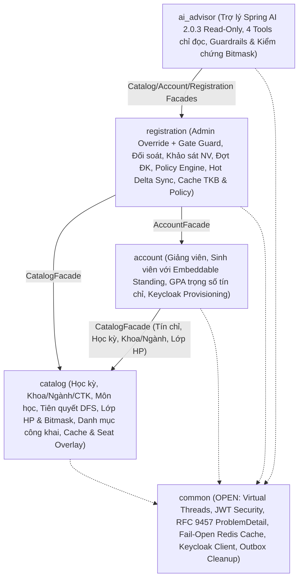
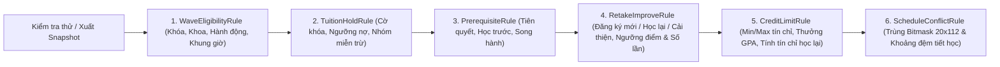
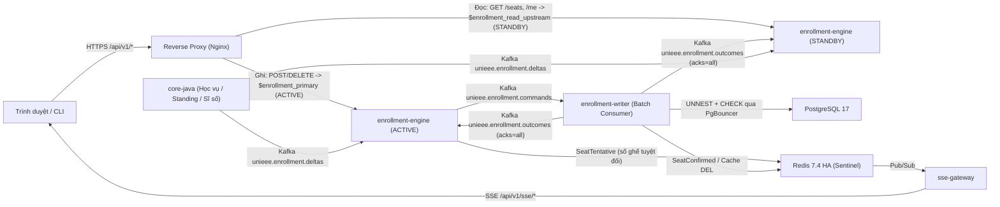

# Kiến trúc Hệ thống & Thiết kế CSDL

**Ngôn ngữ:** [English](../en/architecture.md) | **Tiếng Việt** | [Trung tâm Tài liệu](../README.vi.md)

**unieee** kết hợp một **Spring Boot 4.1.3 Modular Monolith** (Warm/Cold Path chạy 24/7, **`1.0.0`**) với cụm **Rust Hot Path** (**`1.0.0`**, bật theo chu kỳ mở cổng đăng ký), xoay quanh **PostgreSQL 17** làm Source of Truth duy nhất và **Redis 7.4 HA** chỉ đóng vai trò Read Cache & Pub/Sub.

---

## 1. Kiến trúc Lai (Warm/Cold Path vs Hot Path)

| Tiêu chí | Warm / Cold Path (`services/core-java/`) | Hot Path (`services/rust-enrollment/`) |
| :--- | :--- | :--- |
| **Nền tảng** | Java 25 (Virtual Threads), Spring Boot 4.1.3, Spring Modulith 2.1.2, Spring AI 2.0.3 | Rust, Axum 0.8, Tokio, SQLx 0.8, `rdkafka` (`enrollment-engine`, `enrollment-writer`, `sse-gateway`) |
| **Phạm vi** | Chương trình khung, môn học, tiên quyết, học kỳ, lớp học phần, danh mục công khai (`/api/v1/public/*`), cấp phát Keycloak, khảo sát nguyện vọng, Policy Engine & export snapshot, đợt đăng ký, can thiệp Admin, Redis Read-Through Cache & làm ấm cache, Hot Delta Sync (`unieee.enrollment.deltas`), đối soát, Trợ lý AI Read-Only (`ai_advisor`) | Giữ ghế & đọc trạng thái RAM lock-free (`/seats`, `/me`), trừ ghế CAS, kiểm tra trùng lịch Bitmask `O(1)`, Kafka batch ingestion, SQL `UNNEST` batch commit + đồng bộ `unieee.enrollment.outcomes`, fan-out SSE giá trị tuyệt đối |
| **Vòng đời** | Chạy **24/7** (`core` Compose profile) | Bật trước giờ vàng (`prepare-registration` / `open-registration`) và drain sạch trước khi tắt (`close-registration`) |

### Vì sao không dùng Redis làm State Machine giữ ghế?
Dùng Redis Lua script hoặc `DECR` theo từng request phát sinh chi phí network round-trip TCP/RESP và khó phối hợp nhiều ràng buộc lồng nhau (đợt đăng ký, nợ học phí, tiên quyết, quy tắc học lại/cải thiện, trần tín chỉ và trùng lịch). Trong **unieee**, `enrollment-engine` tự kiểm tra toàn bộ quy chế và trừ ghế ngay trong RAM (`#[repr(align(64))]` + sharding theo sinh viên), đồng bộ kết quả ghi đĩa bền vững từ `enrollment-writer` qua topic Kafka `unieee.enrollment.outcomes`, còn Redis chỉ dùng cho Read Cache và Pub/Sub phục vụ `sse-gateway`.

---

## 2. Các Bounded Contexts Spring Modulith (`services/core-java/`)

Core Java được tổ chức thành **4 Bounded Contexts theo Business Capability** trên nền module mở dùng chung (`common`), tạo thành **đồ thị phụ thuộc tuyến tính 1 chiều (không vòng lặp)** được kiểm chứng tự động bằng `ApplicationModules.of(UnieeeApplication.class).verify()`:

### Nguyên tắc Thiết kế Module & DDD
- **Public API vs `internal/`:** Giao tiếp liên module chỉ đi qua interface `*Facade`, DTO `*Request`/`*Response` (`@NamedInterface("dto")`) và Domain Event `*Event` (`@NamedInterface("event")`). Mọi import vào `*.internal.*` của module khác đều bị test kiến trúc chặn đứng.
- **Rich Domain Entity & `@Embeddable` Value Objects:** Bất biến nghiệp vụ nằm trực tiếp trong Entity và Value Object (`CourseSection`, `ScheduleBitmask`, `FinancialStanding`, `AcademicStanding`, `WishSurveyCampaign`, `RegistrationWindow`, `EnrollmentPolicy`).
- **Redis Read-Through Cache Fail-Open (`common.cache`):** Trước và sau khi đóng cổng (`REGISTRATION_CLOSED`), `core-java` cache thời khóa biểu cá nhân (`45s` khi `REGISTRATION_OPEN`, `20m` khi ngoài giờ), active policy (`1h`) và metadata catalog ít đổi (`30m–45m`, trộn lớp phủ sĩ số live từ Redis cho `/api/v1/sections` & `ai_advisor`), tự fallback an toàn về PostgreSQL khi Redis tắt/lỗi và loại trừ hoàn toàn `reconcile`, `roster`, `events` khỏi cache.
- **Outbox Cleanup Job:** Spring Modulith ghi sự kiện vào `public.event_publication` trong cùng transaction với dữ liệu; `EventPublicationCleanupJob` định kỳ dọn các bản ghi đã hoàn tất (`completion_date IS NOT NULL`) quá ngưỡng retention.

---

## 3. PostgreSQL Schema-per-Bounded-Context (`V001`–`V005`)

Mỗi Bounded Context sở hữu schema PostgreSQL riêng, **tuyệt đối không đặt Foreign Key xuyên schema**:

| Schema | Migration | Bảng dữ liệu | Ràng buộc & Thiết kế nổi bật |
| :--- | :--- | :--- | :--- |
| `public` | `V001` | `event_publication` | Spring Modulith Transactional Outbox kèm partial index theo `completion_date`. |
| `catalog` | `V002` | `academic_terms`, `faculties`, `majors`, `curricula`, `courses`, `curriculum_courses`, `course_prerequisites`, `course_sections`, `section_schedules` | `curriculum_courses` tham chiếu `course_id`; phát hiện vòng lặp tiên quyết bằng DFS; `course_sections` lưu `schedule_bitmask_hex` (640 ký tự hex = 20 tuần x 112 bit) và `CHECK (max_capacity >= 0 AND enrolled_count >= 0 AND enrolled_count <= max_capacity)`. |
| `account` | `V003` | `lecturers`, `students`, `student_course_results` | `students` giữ bảng phẳng trên PG để Rust preload 1 query không JOIN, map sang `@Embeddable` `FinancialStanding` & `AcademicStanding` trong Java; `student_course_results` khóa trùng bằng `UNIQUE (student_id, course_id, attempt_number)`. |
| `registration` | `V004` | `enrollments`, `enrollment_events`, `writer_revert_outbox` | Partial unique index `uq_enrollments_active_student_course ON (term_id, student_id, course_id) WHERE status = 'CONFIRMED'`; bảng append-only `enrollment_events` có `BIGSERIAL seq` phục vụ audit và replay. *(Bảng `writer_revert_outbox` được giữ nguyên trong lịch sử Flyway `V004` nhưng không còn ghi/quét ở runtime vì `enrollment-writer` phát kết quả bền vững qua topic Kafka `unieee.enrollment.outcomes`.)* |
| `registration` | `V005` | `wish_survey_campaigns`, `wish_survey_entries`, `enrollment_policies`, `enrollment_policy_snapshots`, `registration_windows` | `uq_survey_student_course` chống trùng nguyện vọng; partial unique index `uq_enrollment_policies_active_term` đảm bảo tối đa 1 policy `active = TRUE` mỗi học kỳ; snapshot JSONB bất biến kèm SHA-256 checksum. |

---

## 4. Single-Writer Gate Guard & Policy Engine Đa trường

### Chốt chặn Single-Writer Gate Guard
Khi học kỳ ở trạng thái `REGISTRATION_OPEN`, cụm Rust Hot Path nắm độc quyền ghi vào `catalog.course_sections` và `registration.enrollments`. Mọi thao tác can thiệp ghi từ Core Java (`ADMIN_ADD`, `ADMIN_DROP`, `ADMIN_TRANSFER`) đều kiểm tra trạng thái học kỳ qua `CatalogFacade` và từ chối ngay với **`409 Conflict` (`errorCode = "REGISTRATION_GATE_OPEN"`)**.

### Policy Engine Cấu hình Đa trường (Phase 5)
Để đáp ứng quy chế học vụ khác nhau của nhiều trường đại học mà không sửa mã nguồn lõi, `EnrollmentPolicy` kết hợp cột tham số chuẩn hóa với cột `extended_rules` (`JSONB`) và được đánh giá qua chuỗi Strategy sắp thứ tự (`EnrollmentRuleEvaluator`):

Trước giờ mở cổng, `PolicySnapshotExporter` biên dịch policy đang kích hoạt cùng các đợt chưa đóng thành JSON chuẩn hóa, tính SHA-256 checksum, lưu phiên bản mới vào `registration.enrollment_policy_snapshots`, cập nhật best-effort lên Redis (`unieee:cache:policy:{termId}:snapshot`) và phát sự kiện `PolicySnapshotExportedEvent`.

---

## 5. Cụm Rust Hot Path (`services/rust-enrollment/` — Phases 6–9, 11–12)

### Các Shared Workspace Crates (`crates/`)
- **`unieee-domain`:** Các kiểu ID định danh mạnh (`TermId`, `StudentId`, `CourseId`, `SectionId`, `EventId`, `WindowId`), `RuleErrorCode`, chuẩn lỗi `ProblemDetail` RFC 9457, và `ScheduleBitmask` (`[u128; 20]` — 20 tuần x 112 bit) hỗ trợ kiểm tra trùng lịch & khoảng đệm `O(1)` được kiểm chứng bằng `proptest`.
- **`unieee-events`:** Bộ codec JSON có phiên bản (`EVENT_SCHEMA_VERSION_V1`) cho thông điệp Kafka (`EnrollmentCommandEvent`, `EnrollmentOutcomeEvent`, `EnrollmentDeltaEvent`, `DeadLetterEvent`) và Redis Pub/Sub (`SeatTentativeEvent`, `SeatConfirmedEvent`, `RevertEvent`, `GateControlEvent`), cùng hàm chuẩn hóa tên topic/key.
- **`unieee-cacheline`:** Cấu trúc `SectionSeatSlot` căn lề `#[repr(align(64))]` (khẳng định `align_of::<SectionSeatSlot>() == 64` để chống *false sharing*) và `ShardedMap` phân mảnh trạng thái sinh viên lock-free.

### Luồng dữ liệu Hot Path, Đồng bộ Outcome qua Kafka & Phân tách Đọc/Ghi

### Các Điểm nhấn về Độ bền, Đọc RAM & Bảo vệ Biên
- **Đồng bộ Bền vững qua Kafka (`unieee.enrollment.outcomes`) & Chunking `UNNEST` Không xung đột:** `enrollment-writer` chia chuỗi thao tác xen kẽ cùng sinh viên/môn học theo thứ tự đến thành các chunk liên tiếp không xung đột (`split_into_conflict_free_chunks`) để giữ thông lượng PostgreSQL `UNNEST` fast-batch cực cao (chỉ fallback tuần tự từng chunk khi vướng constraint/thiếu lớp), đồng thời pipeline các lệnh gửi `EnrollmentOutcomeEvent` (`acks=all`) sang `unieee.enrollment.outcomes` qua `try_join_all` trước khi commit offset Kafka (tự đọc lại trạng thái PG & re-emit khi trùng `event_id` sau crash).
- **State Machine Độc lập với Redis Pub/Sub & 2 Endpoint Đọc RAM:** Cả `ACTIVE` và `STANDBY` của `enrollment-engine` đều tiêu thụ `unieee.enrollment.outcomes` (ngừng subscribe `unieee:seat:confirmed` và `unieee:enrollment:revert` trên Redis Pub/Sub) để chuyển trạng thái idempotent trong RAM (`Reserved -> Confirmed`, `DropPending -> Dropped`, hoặc `Reverted` + hoàn ghế & tính lại bitmask). Ngoài ghi, engine mở `GET /api/v1/enrollments/seats?termId=...` (đọc lock-free từ `SectionSeatSlot`) và `GET /api/v1/enrollments/me?termId=...` (đọc shard của đúng `student_id` trong JWT).
- **Xác thực JWT không nghẽn & Gộp Pub/Sub Giá trị Tuyệt đối:** `enrollment-engine` và `sse-gateway` xác thực JWT cục bộ qua một luồng background JWKS singleflight (`JWKS_REFRESH_INTERVAL_SECS=300`) kết hợp cache SHA-256 ngắn hạn (`JWT_CACHE_TTL_SECS=30`). `SeatTentativeEvent` (`enrollment-engine`) và `SeatConfirmedEvent` (`enrollment-writer`) luôn phát **số ghế trống tuyệt đối (`availableSeats`, `maxCapacity`)** thay vì delta `+1`/`-1`, nên dù Redis Pub/Sub rơi gói tin vẫn tự đồng bộ ở sự kiện kế tiếp. Biến động tạm thời được gộp (`COALESCE_WINDOW_MS=50`, flush tức thì khi `availableSeats == 0`) qua Redis pipeline.
- **Phân tách Đọc/Ghi Nginx (`$enrollment_read_upstream`) & Micro-cache `1s`:** Khi cả hai node engine đều `READY`, Nginx tách `$enrollment_primary = ACTIVE` (ghi) và `$enrollment_read_upstream = STANDBY` (đọc). Khi `ACTIVE` chết và `STANDBY` được promote (chỉ còn 1 node sống) hoặc node cũ đang `SYNCING` (`/readyz = 503`), cả hai biến trỏ về node `ACTIVE` còn sống kết hợp `seats_cache` (`1s`, `proxy_cache_lock on`) cho `GET /api/v1/enrollments/seats`. Khi node cũ replay xong và quay lại ở vai trò `STANDBY`, Nginx giữ nguyên quyền ghi (không auto-failback) và tự động tách lại luồng đọc sang `STANDBY`.
- **Phục hồi Không chạm PostgreSQL:** Sau preload, engine ghi disk snapshot nguyên tử (`SNAPSHOT_DIR`, SHA-256 + `checkpoint_seq`). Khi khởi động lại, engine giữ `/readyz = 503`, nạp lại từ disk snapshot + replay Kafka (`commands` + `deltas` + `outcomes`) với **0 câu query vào PostgreSQL** và gia nhập ở vai trò `STANDBY` (`REJOIN_AS_STANDBY_ON_RECOVERY=true`).
- **Nginx Public Catalog Cache Lock:** `/api/v1/public/sections` và `/api/v1/public/courses` dùng `proxy_cache catalog_cache` kết hợp `proxy_cache_lock on` và `proxy_cache_use_stale ... updating` để hấp thụ đột biến lượt đọc.

---

## 6. Event Bus, Khóa Redis & Hệ thống Pub/Sub

| Kênh / Kho lưu | Tên định danh | Producer -> Consumer | Mục đích |
| :--- | :--- | :--- | :--- |
| **Kafka Topic** | `unieee.enrollment.commands` *(12 partitions)* | `enrollment-engine` -> `enrollment-writer`, replay phục hồi | Luồng lệnh đăng ký/hủy bền vững phân vùng theo `student_id`. |
| **Kafka Topic** | `unieee.enrollment.outcomes` *(12 partitions)* | `enrollment-writer` -> `enrollment-engine` (Active & Standby), replay phục hồi | Kết quả bền vững `CONFIRMED` / `REVERTED` (`acks=all`, partition key = `student_id`), thay thế `writer_revert_outbox` ở runtime. |
| **Kafka Topic** | `unieee.enrollment.deltas` *(6 partitions)* | `core-java` (`KafkaHotDeltaPublisher`) -> `enrollment-engine` (Active & Standby) | Đồng bộ nóng `StudentStandingUpdatedEvent` & `SectionCapacityUpdatedEvent` khi cổng đang `REGISTRATION_OPEN`. |
| **Kafka Topic** | `unieee.enrollment.dlq` *(3 partitions)* | `enrollment-writer` -> Ops kiểm tra | Hàng đợi thư chết cho payload Kafka lỗi không thể xử lý. |
| **Redis Pub/Sub** | `unieee:seat:tentative` | `enrollment-engine` -> `sse-gateway` | Biến động sĩ số tạm thời đã gộp nhóm từ RAM (`TENTATIVE`, mang `availableSeats` & `maxCapacity` tuyệt đối). |
| **Redis Pub/Sub** | `unieee:seat:confirmed` | `enrollment-writer` -> `sse-gateway` | Xác nhận ghi đĩa PostgreSQL thành công cho UI SSE (`CONFIRMED`, mang `availableSeats` & `maxCapacity` tuyệt đối). |
| **Redis Pub/Sub** | `unieee:enrollment:revert` | `enrollment-writer` -> `sse-gateway` | Sự kiện hoàn tác cho luồng SSE cá nhân (`REVERTED`; `enrollment-engine` đã chuyển sang tiêu thụ Kafka `unieee.enrollment.outcomes`). |
| **Redis Pub/Sub** | `unieee:gate:control` | `scripts/unieee.sh` -> `enrollment-engine`, `sse-gateway` | Chuyển trạng thái cổng (`OPEN`, `DRAINING`, `CLOSED`) và đổi đợt không cần restart kèm fencing `epoch`. |
| **Redis Keys** | `unieee:cache:term:{termId}:sections` `unieee:cache:section:{sectionId}:seats` `unieee:cache:student:{studentId}:term:{termId}:timetable` `unieee:cache:policy:{termId}:active` `unieee:cache:policy:{termId}:snapshot` `unieee:cache:catalog:{terms\|term:*\|courses\|course:*\|course:*:prerequisites\|sections:term:*\|section:*:detail}` `unieee:event:status:{eventId}` `unieee:revert:dedup:{eventId}` | `core-java` & `enrollment-writer` -> `core-java`, `ai_advisor`, `enrollment-engine`, client | Lớp Read-Through Cache fail-open (`core-java`: catalog, active policy, thời khóa biểu thích ứng), cache sĩ số `warm-cache` & đồng bộ sau commit cho `/api/v1/sections` & `ai_advisor`, cache policy snapshot, tra cứu trạng thái event và khóa chống trùng revert 24h dự phòng. |

---

## 7. Kiến trúc Giám sát Observability (`infra/compose.monitoring.yml`, Phase 12)

- **Instrumentation:** `core-java` xuất Micrometer `/actuator/prometheus` (`UnieeeMetrics` cho Redis Read-Through Cache hit/miss/fallback, Seat Overlay, Policy Engine, Admin Override, Hot Delta Sync và AI Advisor); cả 3 dịch vụ Rust xuất `/metrics` chuẩn Prometheus qua `metrics-exporter-prometheus`.
- **Thu thập Nội bộ & Cô lập Mạng:** **Prometheus** (`127.0.0.1:9090`, bật `--web.enable-remote-write-receiver` cho `k6`) scrape các target nội bộ qua mạng `app`/`data` (`core-java:8080`, `enrollment-engine-{active,standby}:8081`, `enrollment-writer:8082`, `sse-gateway:8083`, `nginx-exporter:9113` qua Nginx `:8089 /stub_status`, `postgres-exporter:9187`, `pgbouncer-exporter:9127`, multi-target `redis-exporter:9121` và `kafka-exporter:9308` khi chạy `hot-path`). **PostgreSQL, PgBouncer, Redis, Kafka và toàn bộ exporter tuyệt đối không mở port ra host.**
- **Dashboards:** **Grafana** (`127.0.0.1:3000`) tự động nạp datasource Prometheus cùng hai dashboard sẵn có (`unieee-production-overview` và `unieee-k6-benchmark`).
