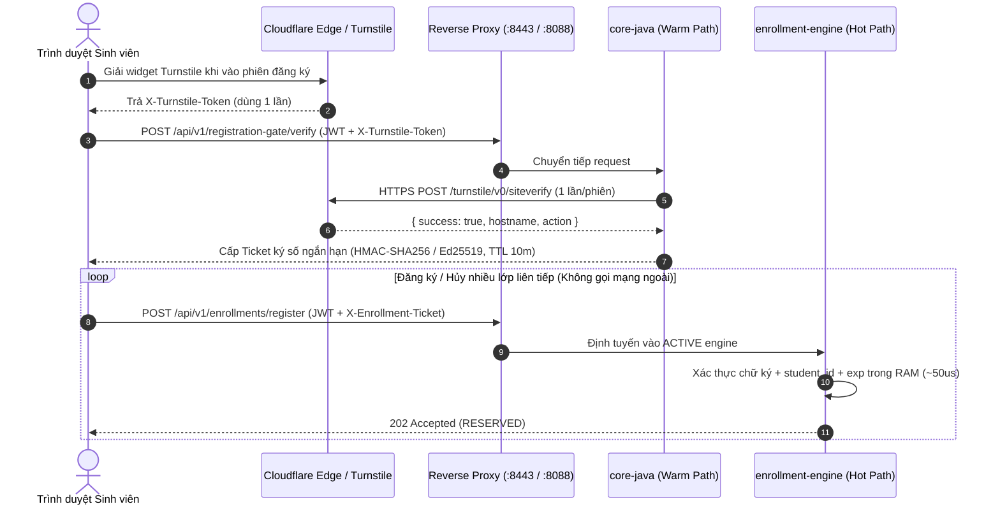
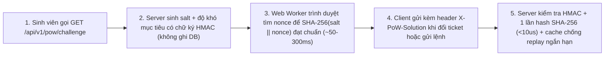

# Hướng dẫn Rate Limiting & Tích hợp Anti-Bot

**Ngôn ngữ:** [English](../en/rate-limiting-and-anti-bot.md) | **Tiếng Việt** | [Trung tâm Tài liệu](../README.vi.md)

Trong khung giờ mở cổng đăng ký tín chỉ, cả lưu lượng người thật (*flash crowd*) lẫn các script tự động (*bot*) đều gửi yêu cầu ở tần suất rất cao, thường đi chung qua một vài địa chỉ IP NAT của ký túc xá hoặc mạng nội bộ trường. **unieee** bảo vệ tính công bằng (*fairness*) bằng cơ chế **Token Bucket Rate Limiting ở từng service** định danh theo người dùng (`student_id` / `sub` trong JWT), tách biệt hoàn toàn khỏi overlay benchmark và dọn đường kiến trúc sẵn cho **Cloudflare Turnstile** cùng **Proof-of-Work tự host (ALTCHA / WebCrypto Hashcash)**.

---

## 1. Token Bucket Rate Limiting tại Từng Service

### Vì sao chỉ chặn theo IP tại Nginx là chưa đủ?
Giới hạn tốc độ ở tầng biên ([nginx.conf](../../infra/reverse-proxy/nginx.conf)) sử dụng khóa `$binary_remote_addr`. Trong mạng đại học, hàng nghìn sinh viên hợp lệ dùng chung một IP NAT ra Internet:
- **Siết quá chặt theo IP:** Nhiều sinh viên dùng chung Wi-Fi/NAT bị vạ lây lỗi `429` chỉ vì một vài máy chạy script spam.
- **Mở quá rộng theo IP:** Một tài khoản bot có thể xả request liên tục vào `POST /api/v1/enrollments/register` hoặc mở/đóng kết nối SSE liên hoàn nhằm chiếm dụng tài nguyên.

Vì vậy, **unieee** bổ sung **Token Bucket Rate Limiting tại từng service tương tác trực tiếp với người dùng**, ưu tiên định danh theo JWT đã xác thực (`student_id` -> `lecturer_id` -> `sub`) và chỉ fallback sang IP client (`X-Real-IP` / `X-Forwarded-For`) cho các endpoint công khai không cần JWT.

### Cấu hình Bucket Mặc định Theo Service

| Service | Bucket | Nhóm Endpoint | Khóa định danh | Burst mặc định (`capacity`) | Tốc độ hồi (`refill`) | Metric Prometheus |
| :--- | :--- | :--- | :--- | :---: | :---: | :--- |
| **`core-java`** | `public_catalog` | `/api/v1/public/**` | IP Client | `60` | `20.0 req/s` | `unieee_rate_limit_requests_total{service="core-java",bucket="public_catalog"}` |
| **`core-java`** | `general_api` | `/api/v1/**` *(trừ public & AI)* | `student_id` / `lecturer_id` / `sub` *(fallback IP)* | `120` | `40.0 req/s` | `unieee_rate_limit_requests_total{service="core-java",bucket="general_api"}` |
| **`core-java`** | `ai_advisor` | `/api/v1/ai/**` | `student_id` / `sub` | `6` | `0.2 req/s` *(1 req / 5s)* | `unieee_rate_limit_requests_total{service="core-java",bucket="ai_advisor"}` |
| **`enrollment-engine`** | `write` | `POST /api/v1/enrollments/{register,drop}` | `student_id` / `sub` *(fallback IP)* | `10` | `2.0 req/s` | `unieee_engine_rate_limit_total{bucket="write"}` |
| **`enrollment-engine`** | `read` | `GET /api/v1/enrollments/{seats,me,status/*}` | `student_id` / `sub` *(fallback IP)* | `40` | `15.0 req/s` | `unieee_engine_rate_limit_total{bucket="read"}` |
| **`sse-gateway`** | `connect` | `GET /api/v1/sse/{sections,me}` | `student_id` / `sub` *(fallback IP)* | `10` | `2.0 req/s` | `unieee_sse_rate_limit_total{bucket="connect"}` |

### An toàn Bộ nhớ, Sharding Không Lock Toàn cục & Chuẩn Lỗi RFC 9457
- **Không dùng Global Lock trên Hot Path:** Cả `enrollment-engine` và `sse-gateway` dùng chung `ShardedTokenBucket` trong `crates/unieee-cacheline`, phân mảnh qua `256` shard căn lề cache-line `#[repr(align(64))]` bằng FNV-1a và tính toán micro-token số nguyên `u128` chính xác.
- **Giới hạn Bộ nhớ & Tự động Dọn dẹp:** Task nền định kỳ dọn các bucket không hoạt động quá `idle_ttl` (mặc định `10 phút`), đồng thời giới hạn trần `maxBuckets` / `max_entries` (ưu tiên xóa bucket hết hạn hoặc cũ nhất trước) để không rò rỉ RAM qua nhiều ngày mở cổng.
- **Header & Chuẩn RFC 9457:** Mọi response hợp lệ đều kèm `X-RateLimit-Limit` và `X-RateLimit-Remaining`. Khi vượt ngưỡng, service trả về **`429 Too Many Requests`** (`Content-Type: application/problem+json`) kèm `Retry-After`:

```json
{
  "type": "urn:unieee:error:RATE_LIMIT_EXCEEDED",
  "title": "Too Many Requests",
  "status": 429,
  "detail": "Rate limit exceeded for 'write'. Please retry after 1 second(s).",
  "instance": "/api/v1/enrollments/register",
  "errorCode": "RATE_LIMIT_EXCEEDED",
  "timestamp": "2026-11-27T03:00:00Z"
}
```

### Tách biệt Hoàn toàn khỏi Hệ thống Benchmark
Trong vận hành bình thường (`compose.base.yml`, `compose.hotpath.yml`, `scripts/unieee.sh`), mọi rate limiter **MẶC ĐỊNH BẬT (`ENABLED=true`)**. Chỉ khi chạy benchmark tải cao với cờ `--disable-rate-limit` trong [tests/load/run-benchmarks.sh](../../tests/load/run-benchmarks.sh), hệ thống mới nạp overlay cô lập [tests/load/compose.bench.yml](../../tests/load/compose.bench.yml):
1. Áp dụng `nginx-bench.conf` cho `reverse-proxy` và truyền `UNIEEE_RATE_LIMIT_ENABLED=false` / `RATE_LIMIT_ENABLED=false` cho các service.
2. Service ghi rõ **`SECURITY WARNING`** khi khởi động ở trạng thái tắt và phản ánh qua `unieee_rate_limit_enabled=0` / `rateLimitEnabled: false`.
3. Cơ chế `trap ... EXIT` tự động khôi phục 100% container về cấu hình mặc định (rate limit BẬT) ngay sau khi benchmark kết thúc hoặc bị ngắt.

---

## 2. Hướng dẫn Tích hợp Cloudflare Turnstile

**Trạng thái hiện tại:** Đã chuẩn bị sẵn điểm mở rộng kiến trúc (`AntiBotVerificationHook`, cấu hình `unieee.rate-limit.anti-bot.*`, quy ước header `X-Turnstile-Token`), **chưa bật cưỡng chế** (`enabled=false` mặc định).

### Vì sao KHÔNG được gọi `siteverify` Đồng bộ trên từng `POST /register` ở Hot Path?
Việc gọi HTTPS tới `https://challenges.cloudflare.com/turnstile/v0/siteverify` trực tiếp trong handler `POST /api/v1/enrollments/register` của `enrollment-engine` sẽ phá vỡ hoàn toàn thiết kế hiệu năng của Hot Path:
1. **Đội độ trễ thêm 100–300 ms:** `enrollment-engine` xử lý kiểm tra quy chế + Bitmask + trừ ghế trong RAM chưa tới `1 ms` (`p95`). Một vòng TLS WAN ra ngoài Internet khiến độ trễ tăng gấp hàng trăm lần và nhanh chóng làm cạn pool kết nối HTTP bất đồng bộ khi có 20.000+ sinh viên đồng thời.
2. **Rủi ro nghẽn Rate Limit / Lỗi Mạng Ngoại vi:** Bão request `siteverify` từ server trường ra Cloudflare dễ chạm ngưỡng giới hạn hoặc lỗi timeout tạm thời, làm gián đoạn toàn bộ phiên đăng ký dù PostgreSQL, Kafka, Redis và cụm Rust đều khỏe.
3. **Xung đột Token Dùng Một Lần (Single-use):** Mỗi token Turnstile chỉ hợp lệ cho một lần verify. Nếu sinh viên chọn nhanh 4–6 lớp liên tiếp hoặc trình duyệt retry với `Idempotency-Key`, token cũ sẽ bị từ chối gây lỗi trải nghiệm.

### Kiến trúc Đề xuất: Cấp Vé Phiên Đăng ký Ngắn hạn (*Pre-Registration Enrollment Gate Ticket*)

Xác thực Turnstile **một lần ở bước lấy phiên/vào phòng chờ** trên Warm Path (`core-java`), sau đó cấp **Enrollment Gate Ticket** có chữ ký số (`HMAC-SHA256` hoặc `Ed25519`, TTL `5–15 phút`) để Rust `enrollment-engine` kiểm chứng hoàn toàn trong RAM (`~50 µs`, **0 network I/O ra ngoài**):



### Phối hợp với `--tls-mode cloudflared` & Cổng Nginx `:8088`
- **Bảo toàn IP thực từ Cloudflare Tunnel:** Khi chạy `./scripts/unieee.sh up --tls-mode cloudflared`, lưu lượng đi vào listener nội bộ `:8088` của Nginx. Hãy cấu hình `ngx_http_realip_module` (`set_real_ip_from` chỉ tin cậy dải subnet container chạy `cloudflared` và `real_ip_header CF-Connecting-IP;`) để không bị nhận nhầm IP nội bộ của container `cloudflared`, đồng thời vẫn lấy `student_id` trong JWT làm khóa bucket chính để bảo vệ sinh viên dùng chung NAT.
- **Điểm mở rộng đã sẵn sàng trong `core-java`:** Giao diện [AntiBotVerificationHook.java](../../services/core-java/src/main/java/vn/edu/unieee/common/ratelimit/AntiBotVerificationHook.java) đã được gắn vào [TokenBucketRateLimitFilter.java](../../services/core-java/src/main/java/vn/edu/unieee/common/ratelimit/TokenBucketRateLimitFilter.java) cùng các biến cấu hình `unieee.rate-limit.anti-bot.*` trong [application.yml](../../services/core-java/src/main/resources/application.yml) (`enabled: false`, `turnstile-header: X-Turnstile-Token`). Khi triển khai thực tế, chỉ cần cung cấp bean triển khai mới mà không phải sửa filter lõi.

---

## 3. Các Phương án Proof-of-Work (PoW) Tự Host / Độc lập Nhà cung cấp

Đối với mạng nội bộ trường đại học (campus LAN / VPN phòng máy) hoặc môi trường không muốn phụ thuộc vào dịch vụ CAPTCHA bên thứ ba, **Proof-of-Work (PoW)** tự host tạo ra rào cản CPU xác định bằng **WebCrypto API** chuẩn có sẵn trên mọi trình duyệt hiện đại (`crypto.subtle.digest`).

### Luồng Challenge–Response Không Trạng thái (ALTCHA / SHA-256 Hashcash)



- **ALTCHA:** Sử dụng challenge JSON gọn có chữ ký HMAC (`{ algorithm: "SHA-256", challenge, maxnumber, salt, signature }`), giải nền bằng Web Worker, không cần ghép hình ảnh gây khó chịu cho người dùng.
- **Không làm nghẽn Hot Path:** Phía server chỉ tốn 1 phép HMAC + 1 phép hash SHA-256 (`< 10 µs`) và tra cứu chống dùng lại `salt` trong `ShardedMap` / Redis.

### Độ khó Thích ứng (Adaptive Difficulty) Gắn với Trạng thái Token Bucket

Vì `TokenBucketRateLimiter` và `ShardedTokenBucket` luôn trả về số token còn lại (`remaining`), hệ thống có thể tăng/giảm độ khó PoW tự động theo hành vi thực tế:

| Trạng thái Token Bucket | Độ khó PoW Đề xuất | Thời gian giải trên Trình duyệt | Tác dụng |
| :--- | :---: | :---: | :--- |
| Bình thường (`remaining >= 50%` burst) | `0` *(bỏ qua PoW)* | `0 ms` | Sinh viên thao tác tự nhiên hoàn toàn không thấy độ trễ. |
| Tải dồn (`remaining < 50%` burst) | Thấp (`~50k` hashes) | `~50–150 ms` | Gần như vô hình với người thật, kìm hãm bot bắn request liên hoàn. |
| Chạm ngưỡng (`remaining == 0` / dính `429`) | Cao (`~250k–500k` hashes) | `~300–900 ms` | Ép chi phí CPU tăng vọt lên bot tự động trong lúc chờ hồi token. |

---

## 4. So sánh Cloudflare Turnstile vs Proof-of-Work Tự Host

| Tiêu chí | Cloudflare Turnstile (Gate Ticket) | Proof-of-Work Tự host (ALTCHA / Hashcash) |
| :--- | :--- | :--- |
| **Phụ thuộc Mạng ngoài** | Cần kết nối Internet tới `challenges.cloudflare.com`. | **Không phụ thuộc** — chạy 100% trong mạng nội bộ / intranet trường. |
| **Ảnh hưởng Độ trễ Hot Path** | `~50 µs` khi dùng Gate Ticket *(tuyệt đối không gọi `siteverify` trong `/register`)*. | `< 10 µs` kiểm tra SHA-256 + HMAC cục bộ. |
| **Tín hiệu Nhận diện Bot** | Phân tích telemetry trình duyệt, TLS fingerprint, tình báo mối đe dọa Cloudflare. | Ép chi phí CPU xác định theo từng challenge (làm chậm quy mô bot thay vì nhận diện trình duyệt). |
| **Quyền riêng tư Dữ liệu** | Gửi tín hiệu trình duyệt qua hạ tầng Cloudflare. | **Tự chủ 100%**, không chia sẻ dữ liệu ra bên ngoài. |
| **Trải nghiệm Người dùng** | Gần như tức thì nếu không bị proxy trường chặn script Cloudflare. | Chạy êm trong Web Worker ở độ khó vừa; độ khó quá cao có thể tốn pin trên điện thoại yếu. |
| **Vai trò Khuyến nghị trong `unieee`** | **Lớp cổng chính** khi chạy Internet/Cloudflare (cấp Ticket 10 phút từ `core-java`). | **Lớp cổng dự phòng / thích ứng** khi bật cảnh báo burst trên Token Bucket hoặc chạy mạng LAN nội bộ. |
